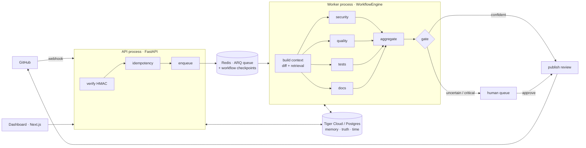
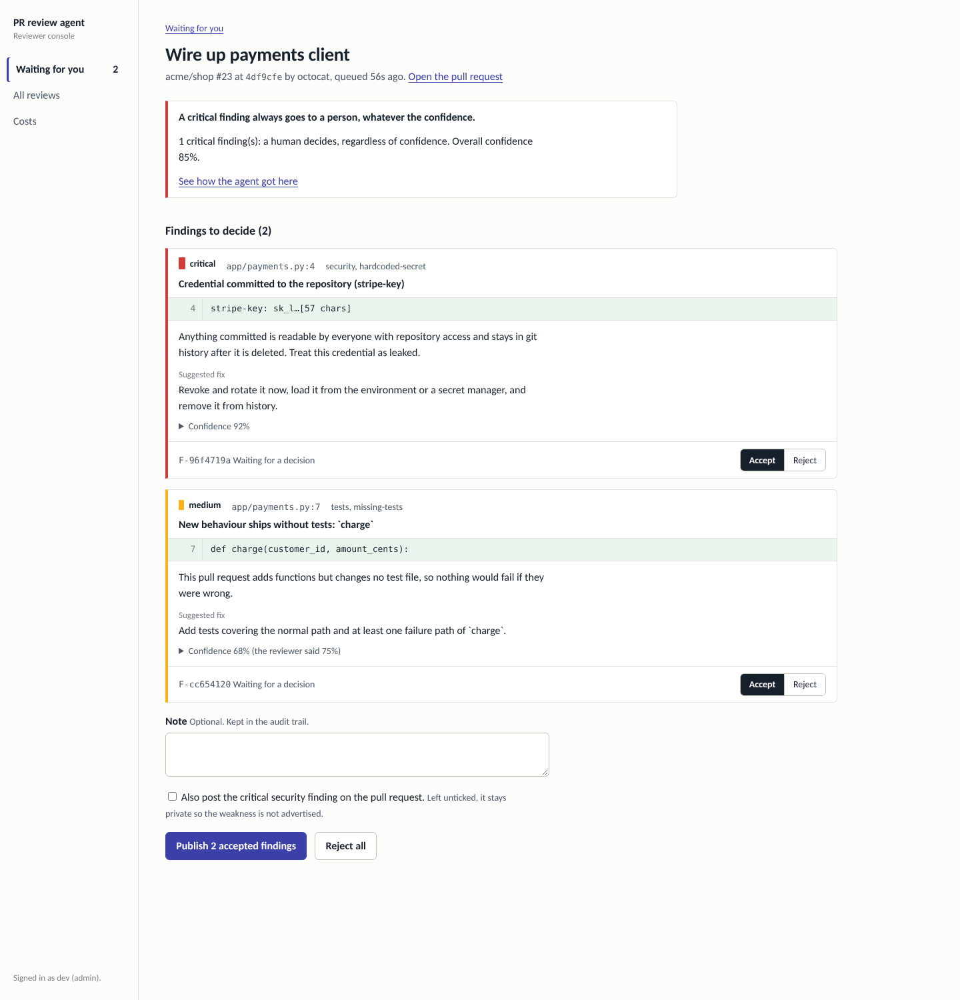
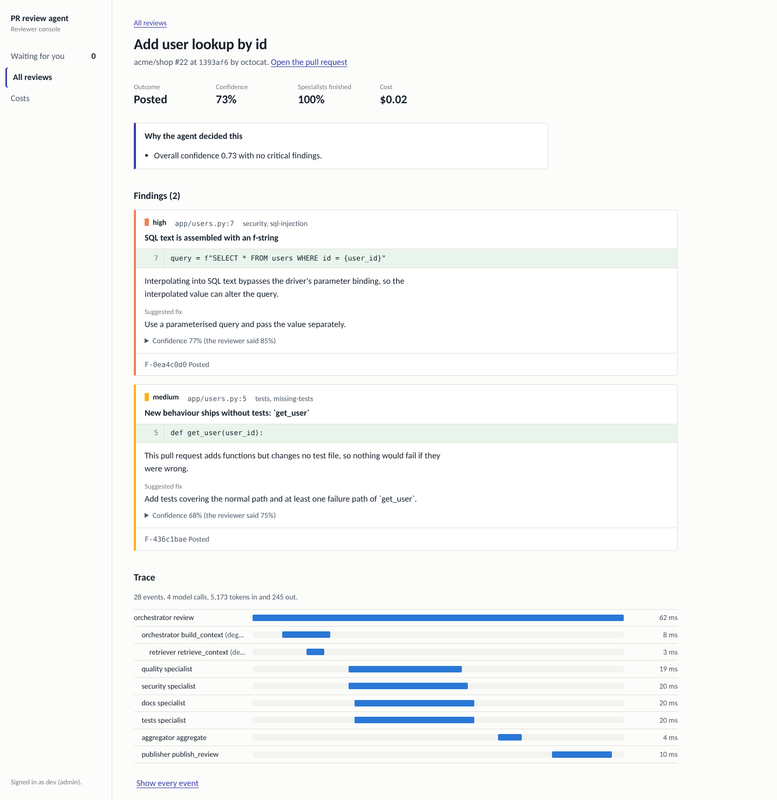
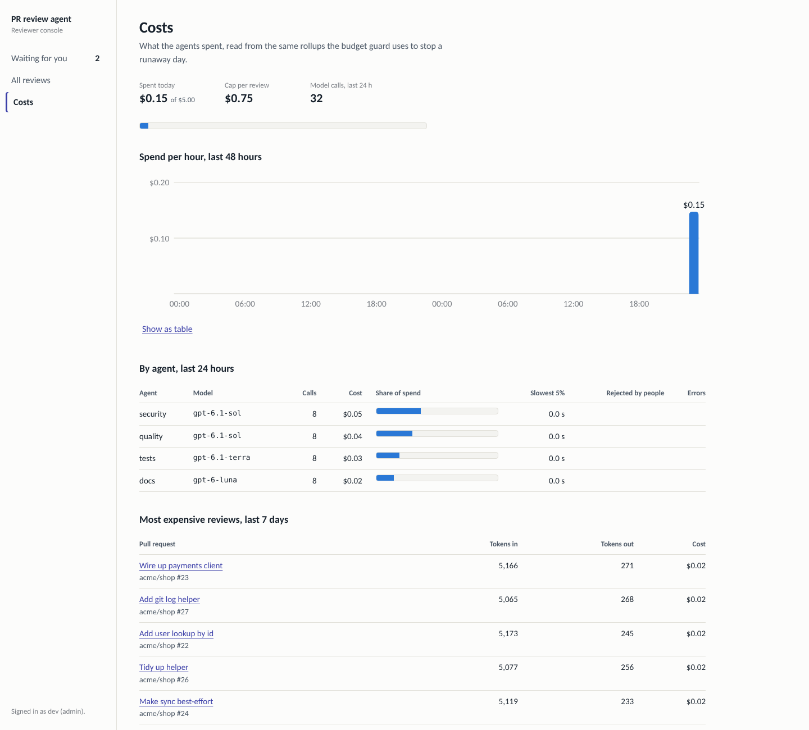

# AI PR Review Agent

[](https://github.com/Vishal-2478/ai-pr-review-agent/actions/workflows/ci.yml)

A multi-agent pull request reviewer built the way a senior engineer reviews: it reads the change from four
angles, checks every claim against the diff, says only what is worth a person's attention, and hands the
uncertain or dangerous cases to a human instead of guessing.

It is a from-scratch build of the system designed in Ayush Singh's
[Designing & Building PR Review Multi Agent System](https://www.youtube.com/watch?v=RiN02OXjeeQ)
([write-up](https://www.antern.co/blogs/production-grade-ai-pr-review-agent/)).

```
GitHub webhook ─► verify · dedupe · enqueue ─► worker ─► 4 specialists in parallel ─► aggregate ─► gate ─┬─► post review
   (ack < 10 s)        FastAPI          Redis/ARQ     security · quality · tests · docs                  └─► human queue ─► post
```

## Try it in one minute (no accounts, no API keys)

```bash
git clone https://github.com/Vishal-2478/ai-pr-review-agent && cd ai-pr-review-agent
python -m venv .venv && . .venv/bin/activate
pip install -e ".[dev]"
make demo
```

`make demo` reviews a sample pull request that commits a payment key. Everything runs in-process: an
in-memory store, a fake GitHub, and the deterministic rule packs standing in for the models.

```
decision: escalate    status: escalated    overall confidence: 0.8143    coverage: 1.0
  - 1 critical finding(s): a human decides, regardless of confidence

[CRITICAL] security app/payments.py:4  conf 0.92  pending_human
    F-96f4719a hardcoded-secret: Credential committed to the repository (stripe-key)
    evidence: stripe-key: sk_l…[57 chars]
[MEDIUM  ] tests    app/payments.py:7  conf 0.55  pending_human
    F-cc654120 missing-tests: New behaviour ships without tests: `charge`

== Human approval queue ==
escalation (priority 402): 1 critical finding(s): a human decides, regardless of confidence
  approved by demo-reviewer -> {'status': 'approved', 'accepted': 2, 'rejected': 0, 'publishing': True}
```

On Windows (cmd), there is no `make`, and the venv is activated differently:

```bat
python -m venv venv
venv\Scripts\activate.bat
pip install -e ".[dev]"
python -m backend.cli demo --case hardcoded-secret --approve
```

`make test` is `python -m pytest -q`, `make eval` is `python -m backend.cli eval`. Put API keys in a `.env`
file in the project folder (it is git-ignored), never in `.env.example`.

Three things to notice: the critical finding went to a person no matter how confident the agent was, the
secret's value is masked everywhere, and after approval the public review mentions only the test gap,
because a vulnerability is never detailed on a public thread unless a maintainer chooses to.

Try other samples with `python -m backend.cli demo --case sql-injection-fstring --approve`, or your own
change with `git diff main | python -m backend.cli demo --diff - --repo-dir .`.

## What it does

| | |
| --- | --- |
| **Ingress** | Verifies the HMAC signature over the raw body before parsing anything, drops redeliveries, queues the work and answers in milliseconds. |
| **Four specialists** | Security, quality, tests and docs run in parallel, each with its own prompt, model and deterministic rule pack. One hung or failing agent cannot block the others. |
| **Grounding** | Every finding must quote code that exists in the diff. Lines are snapped to the evidence; anything that cannot be verified loses confidence and never reaches the pull request on its own. |
| **Repository memory** | Hybrid retrieval over the indexed codebase (vector similarity + full-text on identifiers, fused by rank), plus past review outcomes and team conventions. |
| **Selectivity gate** | Plain code, not a model: suppress noise, auto-post what is confident, queue what is uncertain, always escalate anything critical. |
| **Human in the loop** | An approval queue with per-finding accept/reject, `/dispute F-xxxx reason` from the pull request author, and a learning loop that needs several verdicts from several people before it changes anything. |
| **Event spine** | Every model call, tool call and decision is an append-only row: full trace per review, cost per agent, latency percentiles. |
| **Economics** | Per-agent model routing, a daily and per-review budget checked before each call, automatic downgrade to cheaper models near the cap. |
| **Reliability** | Timeouts on every node, retry with jittered backoff, circuit breakers, checkpointed workflows that resume after a crash without re-running finished agents. |
| **Dashboard** | Approval queue, review and trace viewer, cost view (Next.js). |

## Architecture



One codebase, two processes (the API and the worker) and one database with three jobs:

- **memory**: `code_chunks` with a pgvector column (DiskANN via pgvectorscale) and a generated `tsvector`;
- **truth**: `pr_review_records`, `finding_records`, `hitl_reviews`, `hitl_feedback`;
- **time**: `agent_events`, an append-only hypertable with continuous aggregates for health and cost.

On plain Postgres with pgvector the same schema works with an HNSW index and ordinary views; the migration
runner picks the right files and falls back automatically. The design reasoning, invariants and failure
modes are in [docs/DESIGN.md](docs/DESIGN.md).

## Run it

**1. Offline demo**: `make demo` (above).

**2. A populated system with the dashboard**, still with no accounts:

```bash
make demo-stack        # fake GitHub + fake model API + the real backend, opens sample pull requests
make dashboard         # in a second terminal, then open http://localhost:3000
```

**3. The full stack in containers** (TimescaleDB + pgvector + pgvectorscale, Redis, API, worker, dashboard):

```bash
cp .env.example .env   # set GITHUB_WEBHOOK_SECRET; add ANTHROPIC_API_KEY or OPENAI_API_KEY for model reviews
make up                # dashboard on http://localhost:3000, API on http://localhost:8000
python -m backend.cli send-webhook --unsigned      # 401
python -m backend.cli send-webhook                 # 202, queued
```

**4. A real repository**: create a GitHub App, point its webhook at `/webhooks/github`, deploy the API and
worker. Step by step in [docs/DEPLOY.md](docs/DEPLOY.md). Start a new repository in `AUTONOMY_LEVEL=shadow`:
the agent reviews and records everything and posts nothing until you trust it.

## Dashboard

From `make demo-stack` + `make dashboard`:

| Approval queue: decide finding by finding | Review: findings and the trace of how the agent got there | Costs: spend per agent, read from the rollups |
| --- | --- | --- |
|  |  |  |

The trace shows the four specialists running side by side between context building and aggregation. On the
approval page, a critical security finding stays private unless the reviewer ticks the box to publish it.

## Configuration

Everything is an environment variable, documented in [`.env.example`](.env.example) and
[`backend/config.py`](backend/config.py). The ones that shape behaviour:

| Variable | Default | Meaning |
| --- | --- | --- |
| `AUTONOMY_LEVEL` | `exceptions_only` | `shadow` posts nothing; `human_approves_all` queues every review; `exceptions_only` posts confident reviews and queues the rest. |
| `HITL_CONFIDENCE_THRESHOLD` | `0.6` | Below this, a medium-or-higher finding (or the review as a whole) goes to a person. |
| `NOISE_FLOOR` | `0.3` | Findings below this confidence are recorded and never shown. |
| `LLM_PROVIDER` | `auto` | Anthropic if `ANTHROPIC_API_KEY` is set, else OpenAI, else the rule packs alone. |
| `MODEL_SECURITY` … `MODEL_DOCS` | per provider | Route each specialist to its own model: the strongest for security, the cheapest for docs. |
| `DAILY_BUDGET_USD` / `MAX_COST_PER_REVIEW_USD` | `5` / `0.75` | Checked before every model call. Past the cap, specialists fall back to their rule packs. |
| `API_TOKENS` | empty | `token:role:name` list for the dashboard API (`viewer` < `reviewer` < `admin`). Empty means open in development and disabled in production. |

Default models are `claude-opus-5-5` / `claude-sonnet-5-5` / `claude-haiku-5-5` on Anthropic and
`gpt-6.1-sol` / `gpt-6.1-terra` / `gpt-6-luna` on OpenAI. Prices live in
[`backend/economics/pricing.json`](backend/economics/pricing.json), taken from the providers' pricing pages on
2026-11-14; edit that file when they change.

## Verification

```bash
make test              # 158 tests; Postgres and Redis tests run when TEST_DATABASE_URL / TEST_REDIS_URL are set
make eval              # golden set of 17 pull requests + regression gate
make e2e               # real processes: API + worker + Postgres + Redis, including kill-and-resume
```

CI runs all of this on every push against **both** database flavors (TimescaleDB + pgvectorscale, and plain
Postgres + pgvector), and builds the dashboard.

What that does and does not cover:

| Verified | How |
| --- | --- |
| Ingress contract, pipeline, gate, HITL, learning loop, security guards, API and roles | unit tests on in-memory wiring |
| Migrations, append-only event table, one-review-per-commit under concurrency, hybrid retrieval SQL, Redis checkpoints, ARQ | integration tests on real Postgres and Redis, both flavors in CI |
| Hypertable, continuous aggregates and DiskANN index apply natively | `doctor --strict` in the Tiger CI job |
| Webhook → queue → worker → database → posted review, crash and resume, degraded model | `make e2e` with a fake GitHub and a fake OpenAI-compatible model server over HTTP |
| Real OpenAI reviews (`gpt-6.1-*`), on Windows | the demo and the golden set, run by hand on 2026-11-15: first run exposed the category bug described below, the re-run after the fix passed 17/17 |

| Not verified | Why |
| --- | --- |
| Calls to the real Anthropic API | Tested against a mocked transport only. |
| Model review quality, beyond one run | One real OpenAI evaluation so far (see below). Run `python -m backend.cli eval` with your own key before trusting model reviews. |
| Posting to real GitHub through a GitHub App | Exercised against fakes only. Follow the smoke test in [docs/DEPLOY.md](docs/DEPLOY.md) on a scratch repository first. |
| Docker images and the Railway deployment | The Dockerfiles and `docker-compose.yml` were written but never built: the build environment could not pull base images. |
| Tiger Cloud itself | CI uses the `timescale/timescaledb-ha` image (same extensions), not the managed service. |

### First real-model evaluation

The first golden-set run against OpenAI (2026-11-15) scored security 7/7 with no false alarms, but quality,
tests and docs missed four problems that the rule packs catch on their own. The cause: the prompts gave the
model no fixed category labels, so it named problems in its own words, and rule-pack hits it did not repeat
under the same label were silently dropped. Fixed in prompt `base.v2`: each specialist gets a label
vocabulary, model labels are mapped onto it, and the model must report or explicitly dismiss (with a
reason) every rule-pack lead. A lead it ignores is kept, so adding a model can never lower recall below
the rule packs. The re-run after the fix: 17/17 cases, recall 100% for every agent, no false alarms, no
leaks, $0.22 for the whole set. That is one run on a small set, so model variance is not yet measured.

## Project layout

```
backend/
  webhook_receiver/   signature, event parsing, the /webhooks/github route
  job_queue/          queue port, ARQ worker, job bodies
  core/               WorkflowEngine interface, exception taxonomy
  orchestrator/       workflow nodes, LangGraph engine, asyncio engine, Redis checkpointer
  agents/             Finding contract, four specialists, rule packs, grounding, aggregator
  memory/  data/      embedders, hybrid retriever, chunker, repository indexer
  hitl/               gate, approval queue, disputes, feedback calibration, capacity alerts
  integrations/       GitHub client, diff parser, review formatter, publisher
  database/           Store port, Postgres and in-memory implementations, migration runner
  observability/      event spine, audit, alerting, logging
  reliability/        retry, circuit breaker, timeout, idempotency
  security/           secret masking, prompt-injection guard, roles
  economics/          pricing, budget guard, routing advice
  evaluation/         golden set, judges, regression gate
  prompts/            versioned prompt files and their registry
  api/  main.py       dashboard API and the FastAPI app
  cli.py              demo, eval, migrate, index-local, send-webhook, doctor
frontend/             Next.js dashboard: queue, reviews, trace, costs
scripts/migrations/   SQL, with Tiger-specific files and plain-Postgres fallbacks
scripts/dev/          demo stack, end-to-end drill, fake GitHub and model services
genesis/              done-contract, milestones with demo commands, implementation notes, context graph
docs/                 DESIGN.md, DEPLOY.md
```

## Limits

- The review is advisory. It comments; it never approves, blocks or merges.
- Without an API key the specialists are regex rule packs: useful as a safety net and for CI, not a
  substitute for a model. The golden-set baseline in the repository is for that mode only.
- Indexing reads files through the GitHub API with a file-count and size cap; very large monorepos need a
  tarball-based indexer.
- Python gets symbol-aware chunking; other languages are chunked by line windows.
- Circuit-breaker state is per process, and the dashboard uses static bearer tokens rather than SSO.

## Credits and license

Design and curriculum: Ayush Singh's video and write-up linked above, built following the
[Genesis kit](https://github.com/ayush488-glitch/genesis-kit) ritual (done-contract first, a demo command per
milestone, see [`genesis/`](genesis/)). Code in this repository is MIT licensed.
